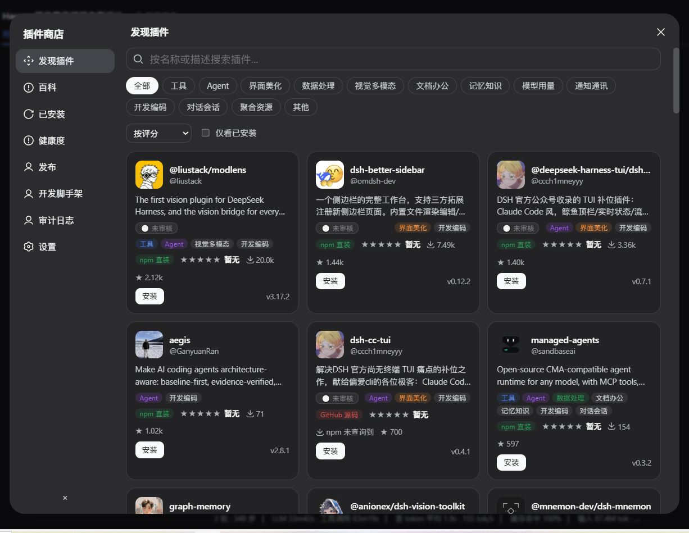
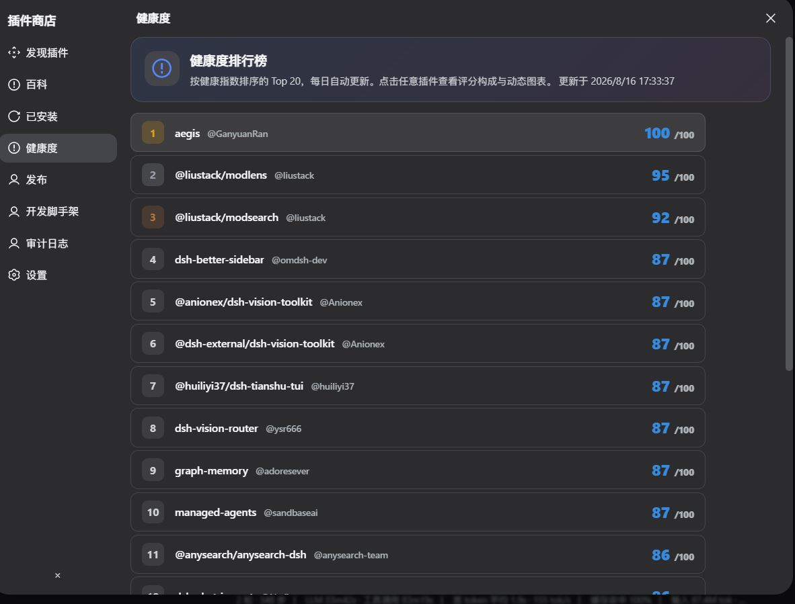
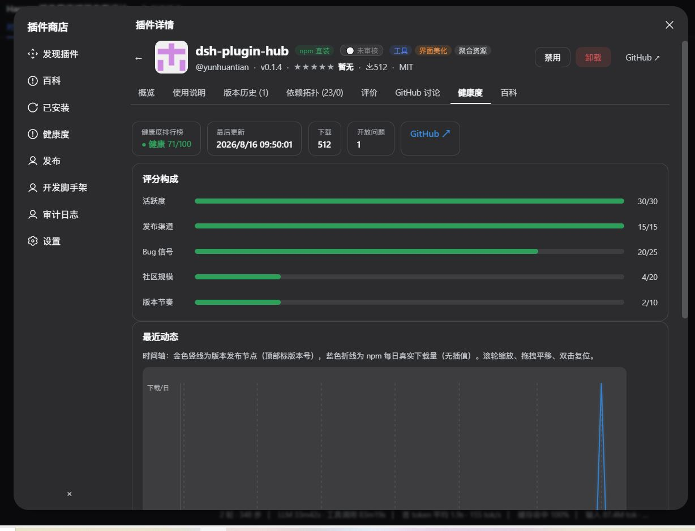
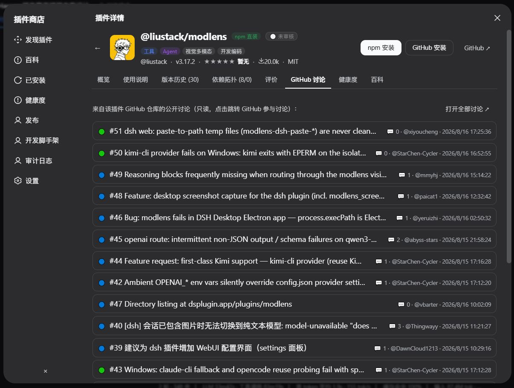

# dsh-plugin-hub — the plugin store for DSH

> A graphical plugin store inside the DeepSeek Harness (DSH) Web UI: browse, search and
> one-click install `dsh-plugin` repositories from GitHub — shipped together with
> **21 built-in plugins** grouped as Foundation / Safety & Quality / Publishing /
> Insight & Content / Operations. Each is individually switchable and declares its
> dependencies. It also ships an **offline seed catalog**: 16 useful plugins are browsable
> and installable the moment you install the hub, without waiting for the first sync.

Built for **DSH `0.1.5-rc.1`** (cordis 4.0.2) · MIT

---

## Preview

**Store front**: 12 categories, card list, trust badges, download-source labels, one-click install


**Health leaderboard**: top-20 health index, refreshed with the mirror sync


**Detail page**: score breakdown, release timeline, npm daily download trend


**GitHub discussions**: read-only issue list for the plugin's repository


---

## One package, 21 internal plugins

Since 0.2 the hub is organised exactly like DSH itself: `@deepseek-ai/dsh` is one package that
contains 60+ `dsh-*` entries, and the hub is **published once, installed once** while being made
of **21 individually switchable** plugins. Each one occupies its own row in DSH's
*Settings → Plugins* inventory — 22 rows in total (core + 21).

**Foundation** — `store-db` (Store Database, `pluginStoreDb`), `github` (GitHub Channel),
`npm-probe` (npm Probe), `seed-catalog` (Seed Catalog), `registry` (Registry Sync),
`installer` (Install Engine) · all on by default.

**Safety & Quality** — `security` (Security Scan), `conflict` (Conflict Detection),
`quality` (Quality Gate), `trust` (Trust Badge Sync) · all on by default.

**Publishing** — `publish` (One-click Publish, on), `version-guard` (Version Guard, on),
`changelog` (Changelog Drafter, **off**).

**Insight & Content** — `usage` (Usage & Cost), `health` (Plugin Health),
`update-check` (Update Check), `dependency-graph` (Dependency Graph) · all on;
`baike` (Plugin Wiki) and `skill-store` (Skill Store) · **off**.

**Operations** — `backup` (Backup & Rollback, on), `diagnostics` (Diagnostics Export, **off**).

### Dependencies are declarative, not injected

Built-in plugins **declare** their dependencies (e.g. `registry → store-db + github`,
`publish → security`) and a single `activate()` resolves them at runtime. Turn off
Store Database and everything above it reports "blocked by dependency" and steps aside —
no service, no UI, no crash — and turning it back on restores the whole chain.

This is deliberately *not* cordis `inject`: a hard dependency would dead-lock into a
permanent `pending` consumer as soon as a user disables the provider. Declarative
dependencies make every shutdown clean and reversible.

### Offline seed catalog

Store content normally comes from the GitHub mirror sync (hundreds of repos, minutes).
A fresh install used to stare at an empty store until it finished. `seed-catalog` ships
**16 widely used plugins** inside the package, so the store is browsable, inspectable and
installable immediately — across vision, UI, memory, notification, cost and dev tooling.

Insert-only rule: once a package has been written by a real sync, the seed never overwrites
it. The catalog version is date-stamped and refreshes only its own rows.

### Two levels of toggling

**Why bundle utility plugins instead of publishing them separately**: the more plugins a user
installs one by one, the longer and more fragile the chain becomes (network, rate limits,
version skew, half-finished installs). Bundled, a single hub install yields four ready
capabilities — and the repository no longer has to maintain four packages and four release
pipelines.

### Two levels of toggling

1. **Install level** — each row in the hub's `cordis.patch.yml` can carry `disabled: true`
   (a deployment decision, edited in the profile layer). The four default-off plugins
   deliberately **omit** it: a `disabled` row is never loaded, so its module could not read
   the settings toggle and switching it on would do nothing;
2. **Everyday level** — *Settings → Plugin Store → Built-in plugins* groups them by area
   and writes `storages/plugin-store/plugins.json`; **takes effect after restarting dsh**.

Disabling a plugin makes it step aside at startup (no service, no UI). The store core is
unaffected either way, and a plugin held back by a missing dependency is shown as
"blocked", not broken.

---

## What the built-in extensions do

### Usage & Cost — a **dated** price table that can reconstruct history

Per-request token and cache-hit timeline (wheel to zoom, drag to pan, double-click to reset),
plus two cost figures from the **versioned price table**:

- **As charged** — the table in effect at request time (= what you actually paid)
- **At today's price** — the latest table applied to the same usage
- When they differ, the delta is shown (`+$0.0123 costs more today` / `−… costs less today`)

Price changes **append** a new version; history is immutable:

| Version | Effective (UTC) | Change |
|---|---|---|
| `2026-08-15` | 2026-08-15 00:00 | baseline: DeepSeek V4 Flash (0731) $0.22 / cache hit $0.007 / output $0.66 |
| `2026-09-10` | 2026-09-10 04:00 | **V4.1 Flash launch**: $0.15 / cache hit $0.003 / output $0.60, peak ×2 |
| `2026-09-14` | 2026-09-14 04:00 | **V4 Pro routed to Flash and billed at the Flash card** |

Peak hours: weekdays **01:00–04:00 and 06:00–10:00 UTC** at double price. Non-DeepSeek vendors
(OpenAI / Anthropic / Google / Qwen / Zhipu / Moonshot) are included too.

> Billing follows DSH's token-meter semantics: `usage.inputTokens` **is** the uncached bucket, so
> billed input = uncached + cache read + cache write. Models missing from the table are never
> estimated silently — the UI says so.

### Plugin Health
Scores plugins 0–100 (healthy / attention / stale) from activity, release cadence and community
signals (stars / downloads / open issues), plus a trust level and leaderboard.

### Update Check / Dependency Graph
Compares installed versions against npm (falling back to GitHub releases, 6h cache) and renders
the dependency / dependent graph so upgrades and removals show their blast radius.

### Backups, version guard, changelog, diagnostics
`backup` takes `VACUUM INTO` snapshots of the database plus toggles and profile manifest (10 kept,
current state saved before any rollback). `version-guard` aligns package.json, the README
changelog, the profile install spec and sub-plugin `exports`. `changelog` drafts a README-style
entry from git history (opt-in). `diagnostics` exports environment + plugin states + audit as
Markdown, with no token plaintext (opt-in).

### Plugin Wiki (off by default)
Aggregates metadata, README highlights, dependencies and related plugins into searchable entries.
Off by default because it depends on external directory sync.

### Skill Store (off by default)
Collects `SKILL.md` skill packages across ecosystems with search and one-click local install.

---

## Store core features

- **Discover**: 12 categories, 7 sort orders, search, installed-only filter
- **Install**: npm registry or GitHub clone; writes the profile `cordis.patch.yml` so cordis picks it up
- **Installed**: `system / downloaded / self-authored` buckets, each split into **ownership
  groups** — the store's own plugins get their own "Plugin Store" group instead of being mixed
  into system components; per-plugin enable/disable (protected system entries are blocked),
  bulk toggle per category, uninstall
- **Quality gate**: dependency completeness + launch-directory checks before install
- **Security scan**: high-risk patterns are rejected before publish
- **Publish**: Markdown description → GitHub + npm in one action (bring your own tokens)
- **Audit log**: installs, uninstalls, toggles, ratings and publishes recorded with actor identity
- **Mirror sync**: caches `topic:dsh-plugin` repository metadata in local SQLite (concurrency pool + session caches)
- **Dependency graph**: dependencies and dependents of a plugin
- **Ecosystem hooks**: reads the local state of dsh-bench (benchmarks) and dsh-connector (IM bridges)

---

## Install

```bash
# from npm (recommended)
dsh plugin --profile web add dsh-plugin-hub

# or build locally (development)
npm install
npm run build
dsh plugin --profile web add <this-directory>
```

After install: a "Plugin Store" button appears at the bottom of the sidebar, and a "Plugin Store"
section appears in Settings (GitHub token, mirror schedule, built-in extension switches).

---

## Architecture

```
dsh-plugin-hub (one npm package)
├─ cordis.patch.yml          inserts 5 rows: core + 4 built-in extensions
├─ lib/host/                 core host half (PluginStoreService, Typert Remote)
├─ lib/extensions/*.js       host half of each extension (separate cordis entries)
├─ lib/contracts/*.js        shared contracts (Remote wire schema + versioned price table)
└─ lib/client.js             the single client bundle (core UI + extension UIs)
```

- **Host**: `PluginStoreService` exposes 20 Remote methods on the `pluginStore` namespace;
  persistence via `node:sqlite`; `installer.ts` installs through pnpm and patches the profile.
- **Coupling between core and extensions**: two state files only —
  `storages/plugin-store/extensions.json` (switches) and `extensions-status.json` (runtime status).
  Extensions do not depend on core services and vice versa.
- **Client**: a package has exactly one client bundle (DSH's `dsh.client` contract), so every
  extension UI lives in it and registers only when its switch is on.
- **Single contract source**: `contracts/pricing.ts` is compiled for host and inlined into the
  client bundle, so the two halves can never disagree on prices.

---

## Development

```bash
npm run build:host    # tsc -p tsconfig.host.json → lib/host/**, lib/extensions/**, lib/contracts/**
npm run build:client  # node scripts/build-client.mjs → lib/client.js
npm run build         # both
npm run typecheck     # host + client type checks
npm run check:contract # contract round-trip: host payload ⨯ zod contract (catches silently stripped fields)
```

### Adding a built-in extension

1. Add a descriptor to `HUB_EXTENSIONS` in `src/host/extensions-state.ts`;
2. Write its host half in `src/extensions/<id>.ts` (honour `isExtensionEnabled`, provide a service,
   report via `writeStatus`);
3. If it has UI, put it in `src/client/extensions/<id>/` and mount it from the switch branch in
   `src/client/index.tsx`;
4. Add a row to the hub's `cordis.patch.yml` (`hub-ext-<id>` / `dsh-plugin-hub/extensions/<id>`);
5. Add `./extensions/<id>` to `exports` in `package.json`.

---

## Changelog

### 0.2.0 (2026-09-11)

**Architecture: the split-off pieces come back — one package, 21 switchable internal plugins**

- `dsh-usage` / `dsh-health` / `dsh-baike` / `dsh-skill-store` are merged into the hub as
  in-package cordis entries (`dsh-plugin-hub/extensions/*`): installed and published with the hub.
- Roster grown from 4 to **21 entries in 5 groups** (Foundation / Safety & Quality / Publishing /
  Insight & Content / Operations): `store-db`, `github`, `npm-probe`, `seed-catalog`, `registry`,
  `installer`, `security`, `conflict`, `quality`, `trust`, `publish`, `version-guard`, `changelog`,
  `usage`, `health`, `update-check`, `dependency-graph`, `baike`, `skill-store`, `backup`,
  `diagnostics`.
- Plugins **declare dependencies** (`registry → store-db + github`, `publish → security`, …) resolved
  at runtime by `activate()`; a disabled dependency puts consumers into a clean, reversible
  `blocked` state instead of a cordis `inject` dead-lock.
- The patch inserts 22 rows (core + 21); each is visible and individually disableable in the
  Plugins inventory.
- Settings now manages them grouped by area, showing state (running / off / blocked / failed),
  dependencies, dependents and counts.
- The four default-off plugins deliberately **omit** `disabled: true` in the patch — otherwise the
  settings toggle would have no effect.

**Offline seed catalog (new)**

- `seed-catalog` ships 16 widely used plugins inside the package so the store is usable before the
  first mirror sync (hundreds of repos, minutes) finishes;
- Insert-only: real synced data always wins; the date-stamped catalog version refreshes its own rows
  only; seeded entries carry a "seed" badge in the list.

**New capabilities (backed by the new built-in plugins)**

- `version-guard`: aligns package.json, README changelog, profile install spec and sub-plugin
  `exports`;
- `changelog`: drafts a README-style entry from git history using Conventional Commits;
- `update-check`: installed vs upstream latest (npm first, GitHub releases fallback, 6h cache);
- `backup`: `VACUUM INTO` snapshots plus rollback that backs up the current state first;
- `diagnostics`: exports environment / inventory / states / audit as Markdown, no token plaintext.

**Usage & Cost: dated price table**

- Versioned price table (`effectiveFrom` / `effectiveTo`), adding `2026-09-10` (V4.1 Flash) and
  `2026-09-14` (V4 Pro billed at the Flash card);
- Per-request "as charged" vs "today's price" with the delta;
- Peak/off-peak multipliers (weekdays 01:00–04:00 / 06:00–10:00 UTC ×2);
- New `pricingTable` Remote so other plugins can reuse the same table.

**DSH 0.1.5-rc.1 adaptation**

- Dropped the removed `dsh-client-runtime` from the client inject list; added
  `dsh-client-ui-conversation` / `dsh-api-remotes`;
- Client externals now match the 0.1.5 seed table (react / cordis / slots / primitives / dockkit);
- The usage view reads nodes from the chat target's `legacy.nodes` (0.1.5 split
  `ConversationSnapshot` into `{views, activeTargets}`).

**Installed view: hub's own things belong to hub, not to "system components"**

- New "Plugin Store" group: the store itself plus its 21 in-package plugins
  (`dsh-plugin-hub/extensions/*`) are collected there and follow the store's own install kind
  (local `file:` ⇒ self-authored, npm ⇒ downloaded);
- Why it was needed: those sub-plugins are separate Loader entries that never appear in the
  profile's dependency table, so the old logic treated them as DSH infrastructure — measured
  **20 of 21 landed in "Other system components"**, the store's own plugins buried in the
  system pile;
- "Other" now belongs to the system track only (relabelled "Other system components"); the
  fallback group for non-system plugins is now "Third-party plugins" — **what you install can
  no longer be labelled a system component**;
- In-package sub-plugins have no individual Uninstall action (they ship and leave with the
  store package) but **can be toggled individually** — same effect as the Settings switch;
- Sub-plugin rows now show their real runtime phase (Running / Disabled) instead of a blank.

**Fixes**

- Host service no longer redeclares `ctx` (clashed with the base class) — renamed to `appCtx`;
- Node cost formula no longer subtracts cache buckets that were already counted;
- State files renamed from `extensions.json` / `extensions-status.json` to
  `plugins.json` / `plugins-status.json` (the old files are still read for compatibility).

### Earlier
0.1.8 bundle-artifact fix · 0.1.7 concurrent mirror sync · 0.1.6–0.1.0 categories, health,
trust badges, wiki, skill store, publish flow.

---

## License

MIT
